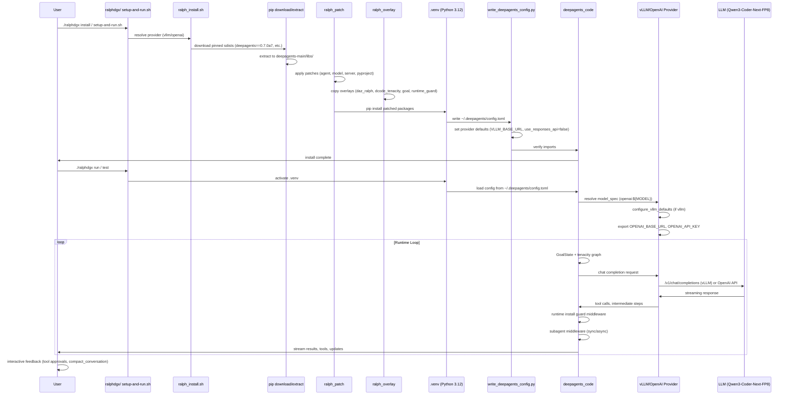
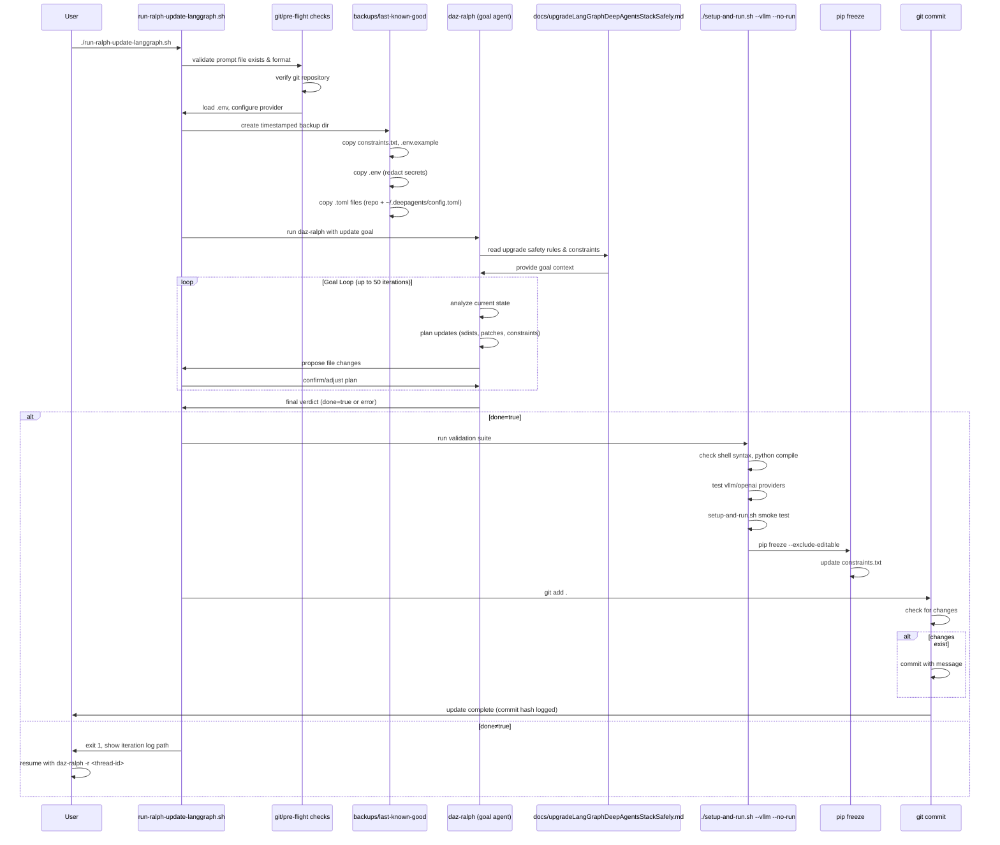

# ralphdgx

DeepAgents Code CLI + Ralph/tenacity goal loop, **adapted for NVIDIA DGX Spark
(GB10 / Linux aarch64)** and a **local vLLM** OpenAI-compatible server.

This is a sibling of the original `ralph` repo (which targets Apple Silicon
OMLX / Hy3-MLX). It keeps the same install → patch → overlay pipeline, but
defaults to:

| Setting | Default |
|---------|---------|
| Provider | `vllm` |
| Model | `Qwen/Qwen3-Coder-Next-FP8` |
| Endpoint | `http://127.0.0.1:8000/v1` |
| Python | **3.12** (auto-preferred) |

## Requirements

- Linux with Python **3.12** + `pip` (system `/usr/bin/python3.12` is fine)
- `ripgrep` (`rg`) for repo search used by DeepAgents
- A local **vLLM** server on `:8000`, **or** a cloud `OPENAI_API_KEY`

On this DGX box, start the local model with:

```bash
~/Desktop/start-vllm.sh                 # Qwen3-Coder-Next-FP8 (coder-next)
# or
~/Desktop/serve-local-llm.sh up coder-next
# optional denser fallback:
~/Desktop/serve-local-llm.sh up qwen27
```

## Quickstart

```bash
cd ~/Desktop/ralphdgx
cp .env.example .env          # already tuned for this host if present
./ralphdgx doctor             # GPU + vLLM + install status
./ralphdgx install            # creates .venv (py3.12) → download → patch → install
./ralphdgx test vllm          # catalog + tiny chat completion
./ralphdgx run                # launch dcode against local vLLM
```

Installs land in **`./.venv`** (not system Python). Activate with
`source .venv/bin/activate` if you want `dcode` / `daz-ralph` on PATH.

All-in-one (install + test + run):

```bash
./setup-and-run.sh --vllm
./setup-and-run.sh --vllm --no-run    # CI-style validate only
```

## CLI

```bash
./ralphdgx install
./ralphdgx run
./ralphdgx run --provider openai
./ralphdgx test vllm
./ralphdgx test openai
./ralphdgx doctor
./ralphdgx update             # safe DeepAgents upgrade workflow
```

Installed entry points (after install):

```bash
dcode --model "openai:Qwen/Qwen3-Coder-Next-FP8" --no-mcp
daz-ralph --model "openai:Qwen/Qwen3-Coder-Next-FP8" --no-mcp
```

## Configuration

`.env` (gitignored) holds provider settings. Important keys:

```bash
DEEPAGENTS_MODEL_PROVIDER=vllm
VLLM_BASE_URL=http://127.0.0.1:8000/v1
VLLM_MODEL=Qwen/Qwen3-Coder-Next-FP8
VLLM_API_KEY=test
VLLM_MAX_INPUT_TOKENS=131072
```

`VLLM_MODEL` **must** match an id from:

```bash
curl -s http://127.0.0.1:8000/v1/models | python3 -m json.tool
```

Cloud OpenAI (optional):

```bash
DEEPAGENTS_MODEL_PROVIDER=openai
OPENAI_MODEL=gpt-5.5
OPENAI_API_KEY=sk-...
```

## How the vLLM provider works

There is no separate dcode “vllm” backend. The `vllm` provider is wired through
dcode’s **`openai`** provider:

1. `model_spec` → `openai:${VLLM_MODEL}`
2. `configure_vllm_defaults` exports `OPENAI_BASE_URL` / `OPENAI_API_KEY`
3. `write_deepagents_config.py` writes `~/.deepagents/config.toml` with
   `base_url` + **`use_responses_api = false`** (vLLM speaks chat-completions
   only; the Responses API would 404)
4. `run_dcode` also passes `--model-params '{"use_responses_api": false}'`
   so it outranks any built-in openai profile default. Ralph’s
   `model_param_filter` keeps that flag on the ChatOpenAI constructor only —
   it is stripped before `model_settings` so it never reaches
   `AsyncCompletions.create()` (which rejects it with TypeError).

## Architecture (same as upstream ralph)

```text
pip download pinned sdists
  → extract into deepagents-main/libs/{deepagents,acp,code}
  → apply Ralph overlays (daz_ralph, dcode_tenacity, goal, runtime_install_guard)
  → pip install patched packages
  → write ~/.deepagents/config.toml
  → verify imports
```

## Workflow Sequence Diagram



## Update Workflow Sequence Diagram



Committed sources of truth: `scripts/ralph_patch/`, `scripts/ralph_overlay/`,
and the DGX-specific shell/Python helpers. `deepagents-main/` and
`deepagents-sdists/` are **gitignored** generated trees.

## Switching models

If you start a different vLLM recipe (e.g. `qwen27`):

1. `~/Desktop/serve-local-llm.sh up qwen27`
2. Update `VLLM_MODEL` in `.env` to the id advertised by `/v1/models`
3. `./ralphdgx install` (rewrites config) or just re-export env and `./ralphdgx run`

## Not included (by design)

- OMLX / MLX Apple Silicon path
- Hy3-MLX-Q9 / vendored mlx-lm
- Micromamba-only install (uses system/conda Python 3.12 directly)

## License

Same as the parent project (see `LICENSE`).
